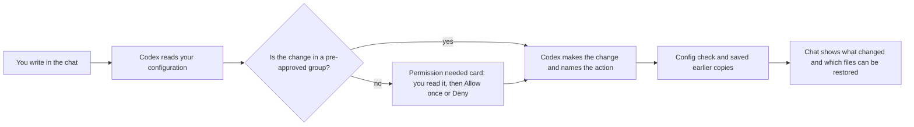

# Codex for Home Assistant

[![License][license-badge]][license-url]

Ask OpenAI's Codex, in plain words, to explain your Home Assistant or to change its configuration. You talk to it in a
chat page inside Home Assistant. It reads your files, proposes a change, shows you what it will do, and waits for you
where it matters.

It is for a household member who looks after the Home Assistant: someone who can read a configuration file when
needed, but who does not want to write every automation by hand. A ChatGPT account with Codex access is required.
As of November 13, 2026, OpenAI lists Codex across ChatGPT plans, including Free and Go. Limits and workspace access
vary. See [OpenAI's current availability](https://help.openai.com/en/articles/11369540-using-codex-with-your-chatgpt-plan).

**Status: pre-release.** Nothing from this fork is installed on a public release yet. The fork is built on
[moryoav/home-assistant-codex](https://github.com/moryoav/home-assistant-codex) release **0.1.81**. See
[Versions](#versions).

## Contents

- [What it does](#what-it-does)
- [An example, step by step](#an-example-step-by-step)
- [How a request is handled](#how-a-request-is-handled)
- [Permission modes and action groups](#permission-modes-and-action-groups)
- [Safety](#safety)
- [Sign-in](#sign-in)
- [Mailbox and schedules](#mailbox-and-schedules)
- [Using it from Assist and automations](#using-it-from-assist-and-automations)
- [Installation](#installation)
- [Updating](#updating)
- [Uninstalling](#uninstalling)
- [Troubleshooting](#troubleshooting)
- [Versions](#versions)
- [Reporting a problem and testing](#reporting-a-problem-and-testing)
- [Credit](#credit)
- [Contributing](#contributing)
- [License](#license)

## What it does

You get a chat page in Home Assistant with saved conversations and a task queue. You write what you want. Codex does
the work in a sandbox and tells you what it did.

**It asks before it does something that matters.** Each pre-approved kind of change is a switch you set. A request
outside those switches shows a **Permission needed** card with the full command or file change. Only a Home Assistant
administrator can answer it.

**You choose the guard rails.** Five groups of everyday actions are pre-approved or not, as you decide. Two of them
start off. See [Permission modes and action groups](#permission-modes-and-action-groups).

**A gate checks every command.** The check answers within 1.5 seconds. If it cannot answer in time, the command is
refused with a plain reason. A card for a command that could hide a write to a protected place has no **Allow once**
button.

**You can undo a change.** Before Codex changes a file, it saves the earlier copy. The chat lists the files that have a
saved copy and names the files that do not. Credential files are never copied.

**Mail between agents and you.** Codex, you and one other local agent can leave plain-text messages in a mailbox. A
message never starts work by itself.

**Schedules you approve.** An agent can propose a recurring run. It stays off until an administrator reviews and
approves it.

**You see when the sign-in is gone.** A banner and a Home Assistant repair tell you when the ChatGPT sign-in is missing
or rejected. See [Sign-in](#sign-in).

**Fixed, checked software.** The Codex program and the base image are pinned by checksum. They cannot update
themselves. A new version arrives only as a new app version that you install.

**A trail of what happened.** Every request and decision stays in the task's `approvals` history, with sensitive values
removed. Anonymized interaction diagnostics stay on your Home Assistant and export only when you ask.

More that you will use every day:

- Answers that Codex offers appear as buttons, in the chat and on phone notifications.
- Dashboards open in a real browser at desktop and phone sizes, so Codex can see its own work.
- A local copy of the Home Assistant documentation, so lookups need no web search.
- State history and statistics, read-only, for questions like "how warm was the kitchen yesterday?"
- Photos and files you attach to a message, up to six, 10 MB each.
- Optional remote control from the ChatGPT app on a phone.

## An example, step by step

You ask: "Turn the porch light on at sunset and off at 11 pm."

1. You write the request. The chat shows it and Codex starts.
2. Codex reads your files and the Home Assistant documentation. It may ask a question and offer two or three short
   answers as buttons.
3. Codex makes the change. If the change needs your permission, the chat stops and shows the command or file diff. You
   choose **Allow once** or **Deny**.
4. Codex runs a configuration check on changed YAML and says what it changed.
5. You read the summary. If you do not like it, ask Codex to undo it, or restore the saved earlier copy.

Screenshots of these screens are listed in [SCREENSHOTS.md](SCREENSHOTS.md).

## How a request is handled

Two parts work together. Both carry the same version number.

- **The app** (`codex-cli-worker`) runs Codex. It has the chat page, the sandbox, the gate, the backups and the
  permission cards. It runs inside Home Assistant as an app (an add-on).
- **The integration** (`custom_components/codex_cli`) connects the app to the rest of Home Assistant. It adds entities,
  actions (`codex_cli.*`), repairs and notification buttons. You need it for those. The chat works without it, and the
  chat shows a line at the top when the integration is missing, old or not connected.

You install the app first, then the integration. See [Installation](#installation).

The web page opens only through Home Assistant Ingress. The app does not open a port on your network. The integration
finds the app by itself; there is no address or token to enter.

## Permission modes and action groups

Each chat turn runs in one of two modes.

| Mode | What Codex can do without asking |
|---|---|
| `read-only` | Read files. A write, or shell networking, needs your permission for that one action. |
| `workspace-write` (default) | Edit files in your configuration folder. Shell networking and writes outside it need your permission. |

This fork has no full-access mode. Full access is on hold. If it ever returns, it will be a new, separate choice that
you turn on yourself. The protected policy inside the app image refuses it today, and an old setting that names it stops
the app at startup, with a log line that says why.

### Pre-approved action groups

In **Settings** > **Permissions overrides**, an administrator turns five groups on or off.

| Group | Starts | What it covers |
|---|---|---|
| Apply my changes | On | Reload automations, scripts, scenes, templates and groups. Run the configuration check. Start or continue an integration setup. |
| Everyday control | On | Turn lights and switches on, off or toggle. Activate scenes. Enable, disable or trigger automations. Set helper values. |
| Organize | On | Change a device or entity name, area and labels. Save a dashboard after its backup succeeds. |
| Bigger changes | Off | Run a script. Change an entity ID, with a report of what refers to it. Back up or restart Core. Delete a device, entity, automation, script or dashboard. |
| Security and people | Off | Locks, alarms, covers and garage doors, cameras, notifications and messages. |

Rules for the groups:

- They apply only to a turn that a person starts in `workspace-write`. Scheduled runs, runs started by another agent and
  `read-only` turns never use them.
- A group judges the service and the things it directly targets. What a scene or a script does next is your own setup.
- Unknown limits, templated values, mixed targets and missing data fall back to the normal permission card.
- A successful action is named in the answer, and the event is recorded before the action runs.
- The tool cannot change its own settings, read credentials or call Supervisor.

You can add limits to the guard rails in a marked block in `/config/AGENTS.md`. The worker keeps a confirmed copy of
that block outside the folder Codex can write to. If the block changes, all groups pause until an administrator uses
**Review and confirm** in Settings.

## Safety

These protections work in order. Each one stands on its own.

1. **The sandbox.** Commands run in a sandbox with its own user, mount, process and network space. Shell networking
   needs your permission for each command.
2. **The gate.** A hook checks each command before it runs. It answers within 1.5 seconds. A late answer is a refusal.
   It refuses commands that reach the Supervisor, the app's own settings or the private sign-in files.
3. **Fail-closed approval.** An action that is incomplete, too large, redacted, or that uses quoting the check cannot
   read can be denied but never allowed. Hidden text could hide a command. A permission card answers only that one
   request, and the answer expires with the exchange.
4. **Administrators only.** Only a signed-in administrator can answer **Allow once** or **Deny**. The integration's token
   cannot answer. Actions that the integration offers refuse a caller who is not an administrator.
5. **The configuration watch.** At the end of an exchange the app checks changed files. A new unsafe file is removed. A
   changed file is restored only from a copy that it verified. If it has no verified copy, the check says it could not
   check, and you review those files before you reload or restart.
6. **A protected policy.** The allowed modes and approval policy come from a file inside the app image, outside the
   folders that Codex can write. Options and chats cannot loosen it.

What the safeguards do not do:

- They do not promise that every action is safe or can be undone. **Read each permission card before you allow it.**
- The command check reads only text. It cannot see a path that a command builds while it runs, or a symbolic link.
- An allowed command runs outside the sandbox, with the app's file and network access.
- Backups depend on Codex following its instructions. Keep your own Home Assistant backups.

The app does not ask for host networking, Docker access, full access or elevated Supervisor roles. It keeps AppArmor on
and ships its own profile. Your `/config` folder is mounted for writing, because editing it is the purpose of the app.

More detail: [Security Model](codex-cli-worker/DOCS.md#security-model), [Sandbox](codex-cli-worker/DOCS.md#sandbox),
and [Backups](codex-cli-worker/DOCS.md#backups).

## Sign-in

Codex uses your ChatGPT account.

1. In ChatGPT, open **Settings** > **Security** and turn on **Enable device code authorization for Codex**.
2. In the chat, open **Settings** and choose **Sign in**.
3. Scan the QR code, or open the link, and enter the one-time code. The code stays on screen until the sign-in ends or
   you cancel it.

The app notices when the sign-in is missing, ended or rejected. A banner returns above the chat, the integration raises
a Home Assistant repair, and the **Signed in** sensor turns off. A good sign-in clears all three.

The Codex program does not report when a sign-in will end. For that reason, the app shows no countdown and sends no
advance warning. It does not guess. Sign out any time with **Settings** > **Sign out**.

Status shows what the app can learn about your plan. It says plainly when it cannot confirm access. A task that works
confirms access for that sign-in.

## Mailbox and schedules

**Mailbox.** The mailbox holds plain-text messages between you, Codex and one other local agent that you connect, such
as a second assistant on another machine. You connect it with a separate token that you create in Settings. The token
shows once, and the app stores only a hash.

- A message is only data. It never runs, and it grants no permission.
- A sensor counts unread messages for the other agent, and an event announces each new message without its text.
- Limits: 500 messages, 20 writes per turn and 64 per day for each writer.

**Schedules.** In **Settings** > **Scheduled runs**, you save a name, a prompt and a time rule. You can use an interval,
a cron rule or a single time, in your Home Assistant time zone.

- A schedule you save is approved when you save it.
- An agent can only propose a schedule. A proposal stays off until an administrator reads the full prompt and approves
  it. An approved schedule can be changed only by an owner.
- A scheduled run asks for permission like any other run. It waits for you to answer in its chat.
- Limits: 100 approved schedules, 24 runs per schedule per day, and 64 scheduled or agent-started runs per day.

## Using it from Assist and automations

The integration adds actions that scripts, automations and Assist can call.

| Action | What it does |
|---|---|
| `codex_cli.start_task` | Start a Codex task with a prompt. |
| `codex_cli.reply_task` | Answer a task that waits for input. |
| `codex_cli.continue_task` | Continue a saved conversation. |
| `codex_cli.get_task`, `codex_cli.list_tasks` | Read a task or the list of tasks. |
| `codex_cli.cancel_task` | Stop a task. |
| `codex_cli.start_login`, `codex_cli.logout`, `codex_cli.get_login_status` | Manage the sign-in. |

A task started this way still uses the normal permission cards. The integration cannot answer them. Home Assistant
sends a notification when a task finishes or waits for you. Set `notify_service` in the app options for phone pushes,
or leave it empty for persistent notifications.

The event `codex_cli_task_result` carries the result for automations. The full list of entities, actions, the task output
format and an Assist example is in the [integration README](custom_components/codex_cli/README.md) and in
[docs/upstream-README.md](docs/upstream-README.md). A starter Assist script is in
[examples/scripts.yaml](examples/scripts.yaml).

## Installation

You need Home Assistant OS or Supervised (the worker is an app), Home Assistant 2026.5 or later, and a ChatGPT plan with
Codex. Turn on **Enable device code authorization for Codex** in ChatGPT before you sign in.

1. **Add the app repository.** **Settings** > **Apps** > **Install app** > menu (top right) > **Repositories**. Add
   `https://github.com/fatherdoctor/ha_codex`.
2. **Install and start the app.** Install **Codex for Home Assistant**, read its options and start it. Choose **Open Web
   UI** on its app page. You can turn on **Show in sidebar** there.
3. **Install the integration.** In Home Assistant 2026.11 or later, open **Settings** > **Marketplace**, choose **Add from
   link**, and add `https://github.com/fatherdoctor/ha_codex` as an integration. Follow the GitHub prompt if it
   appears. Install **Codex** and follow its setup prompts. On older releases, use HACS with the same custom repository
   as an **Integration**. To install by hand, copy `custom_components/codex_cli` to
   `/config/custom_components/codex_cli` and restart.
4. **Add the integration if setup did not open.** **Settings** > **Devices & services** > **Add integration** >
   **Codex**. It finds the app by itself. Restart if Home Assistant asks.
5. **Sign in.** See [Sign-in](#sign-in).

Every app option is in [codex-cli-worker/DOCS.md](codex-cli-worker/DOCS.md).

Put rules for your house in `/config/AGENTS.md`. The chat has an editor for it under **Settings** > **Advanced** >
**Workspace rules**. Codex uses its defaults and your workspace instructions; the app bundles no house rules.

## Updating

The app and the integration have the same version number. Update the app in **Settings** > **Apps**. Update the
integration in **Settings** > **Marketplace** (HACS on older releases). Then restart Home Assistant. Let Home Assistant
take a backup of the app before an app update.

Codex never updates itself. A newer Codex program arrives only inside a newer app image.

How releases are tested and how a bad release is undone: [docs/updates-and-rollback.md](docs/updates-and-rollback.md).

## Uninstalling

1. **Settings** > **Devices & services** > **Codex**. Delete the integration entry.
2. Remove **Codex** in **Settings** > **Marketplace** (HACS on older releases), or delete
   `/config/custom_components/codex_cli`. Restart Home Assistant.
3. Uninstall **Codex for Home Assistant** under **Settings** > **Apps**.

Task logs stay in `/config/codex_tasks` until you delete that folder.

## Troubleshooting

| What you see | What to do |
|---|---|
| A line at the top of the chat says the integration is missing, old or not connected | Install or update the integration. Restart Home Assistant. Add **Codex** under **Devices & services**. |
| A banner offers **Sign in** | The sign-in is missing, ended or rejected. Sign in again. |
| The chat does not take new messages | The assistant may be paused. Choose **Resume the assistant** in the banner. |
| A request waits and nothing moves | A permission card is open. Open the chat and choose **Allow once** or **Deny**. |
| A task stops with no output for 10 minutes | The stall limit (`task_stall_seconds`) ended it. A quiet long command can trigger it. Raise the limit. |
| A task fails before it starts, with a sandbox error | The host may not allow the sandbox. See [the sandbox test steps](codex-cli-worker/SANDBOX_TESTING.md). |
| An answer is wrong or a change broke something | Restore the saved earlier copy that the chat lists, or use a Home Assistant backup. |

## Versions

A fork version is the upstream version plus one number. `0.1.81.1` is the first build of this fork on upstream 0.1.81. A
daily workflow opens one issue when upstream releases something newer.

| Version | Changes |
|---|---|
| 0.1.81.2 (unreleased) | No full-access mode; a protected permission policy in the image, no bundled house rules and owner workspace instructions; permission answers and the integration's actions only from Home Assistant administrators; a permission-prompt sensor. |
| 0.1.81.1 (unreleased) | Codex CLI 0.166.0 pinned by checksum, no self-update, base image pinned by digest, links and maintainer for the fork. |

The full list is in the [changelog](codex-cli-worker/CHANGELOG.md).

## Reporting a problem and testing

This is a pre-release, and testers are welcome. Install it on a test Home Assistant first, not on one that runs your
house.

To report a problem, use the [bug report form](https://github.com/fatherdoctor/ha_codex/issues/new?template=bug_report.yml).
Include:

- The app version, the integration version and your Home Assistant version.
- The steps that cause it.
- The app log lines around the time, and the integration diagnostics file.

Remove tokens, device codes, private URLs and personal configuration before you post. Steps to collect logs:
[Reporting a bug](codex-cli-worker/DOCS.md#reporting-a-bug).

To offer to test, open a [feature request](https://github.com/fatherdoctor/ha_codex/issues/new?template=feature_request.yml)
and say what you will run it on. To report a security problem, use the **Report a vulnerability** button on the
Security tab. See [SECURITY.md](SECURITY.md).

## Credit

This project is a fork of [moryoav/home-assistant-codex](https://github.com/moryoav/home-assistant-codex) by Yoav Mor
(MIT). The upstream reference sections are kept in [docs/upstream-README.md](docs/upstream-README.md).

## Contributing

Issues and pull requests are welcome. Read [CONTRIBUTING.md](CONTRIBUTING.md) first.

## License

MIT, as upstream: [LICENSE](LICENSE) (copyright Yoav Mor). Fork changes are copyright The Backshop, under the same
license.

[license-badge]: https://img.shields.io/github/license/fatherdoctor/ha_codex
[license-url]: LICENSE
