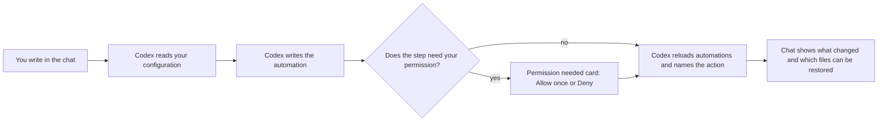

# Codex for Home Assistant

[![License][license-badge]][license-url]

Ask OpenAI's Codex, in plain words, to explain your Home Assistant or to change its configuration. You talk to it in a
chat page inside Home Assistant. It reads your files, proposes a change, and waits for you where it matters. It is for
the household member who looks after Home Assistant and can read a configuration file, but does not want to write
every automation by hand.

**Status: pre-release.** Nothing from this fork is installed on a public release yet. It is built on
[moryoav/home-assistant-codex](https://github.com/moryoav/home-assistant-codex) release **0.1.81**.

## What it does

- A chat page in Home Assistant, with saved conversations and a task queue. Codex works in a sandbox.
- It asks before anything that matters, and only an administrator can answer.
- It saves the earlier copy of a file before it changes it, so you can undo.
- The Codex program is pinned and never updates itself.

## Quick start

1. Add `https://github.com/fatherdoctor/ha_codex` under **Settings** > **Apps** > **Install app** > menu >
   **Repositories**.
2. Install and start **Codex for Home Assistant**.
3. Restart Home Assistant when the notification asks.
4. Add **Discovered: Codex** under **Settings** > **Devices & services**.
5. Open the chat and [sign in](#sign-in).

Details and other ways to install: [Installation](#installation).

## Contents

- [Installation](#installation)
- [Updating](#updating)
- [Uninstalling](#uninstalling)
- [An example, step by step](#an-example-step-by-step)
- [Permission modes](#permission-modes)
- [Safety](#safety)
- [Sign-in](#sign-in)
- [Mailbox and schedules](#mailbox-and-schedules)
- [Using it from Assist and automations](#using-it-from-assist-and-automations)
- [Troubleshooting](#troubleshooting)
- [Versions](#versions)
- [Auditing](#auditing)
- [Reporting a problem and testing](#reporting-a-problem-and-testing)
- [Credit](#credit)
- [Contributing](#contributing)
- [License](#license)

## Installation

You need Home Assistant OS or Supervised (the worker is an app), Home Assistant 2026.5 or later, and a ChatGPT account
with Codex access. As of November 13, 2026, OpenAI lists Codex across ChatGPT plans, including Free and Go. Limits
and workspace access vary. See [OpenAI's current availability](https://help.openai.com/en/articles/11369540-using-codex-with-your-chatgpt-plan).

1. **Add the app repository.** **Settings** > **Apps** > **Install app** > menu (top right) > **Repositories**. Add
   `https://github.com/fatherdoctor/ha_codex`.
2. **Install and start the app.** Install **Codex for Home Assistant**, read its options and start it. At start, the
   app installs the Codex integration of the same version in `/config/custom_components/codex_cli`.
3. **Restart Home Assistant once.** A notification asks for it: **Settings** > **System** > restart.
4. **Add the integration.** **Settings** > **Devices & services** shows **Discovered: Codex**. Choose **Add**. It
   finds the app by itself; there is no address or token to enter. If nothing is shown, choose **Add integration** >
   **Codex**.
5. **Sign in.** Choose **Open Web UI** on the app page to open the chat. You can turn on **Show in sidebar** there.
   Then follow [Sign-in](#sign-in).

The chat works without the integration. The integration adds the entities, the `codex_cli.*` actions, repairs and
notification buttons. The web page opens only through Home Assistant Ingress; the app opens no port on your network.

**Installing the integration yourself.** Turn off the app option **Install the Codex integration**
(`install_integration`) first. Then do one of these, and restart Home Assistant:

- Home Assistant 2026.11 or later: connect a GitHub account, then open **Settings** > **Marketplace** >
  **Custom repositories** and add `https://github.com/fatherdoctor/ha_codex` with the category **Integration**.
  Accept the warning shown the first time, and install **Codex**.
- Older releases: add the same custom repository in HACS as an **Integration**.
- By hand: copy `custom_components/codex_cli` to `/config/custom_components/codex_cli`.

The app never changes an integration folder that it did not install, or that was changed after it installed it. It
says so once in a notification.

Every app option is in [codex-cli-worker/DOCS.md](codex-cli-worker/DOCS.md).

Put rules for your house in `/config/AGENTS.md`. The chat has an editor for it under **Settings** > **Workspace instructions** >
**Workspace rules**. Codex uses its defaults and your workspace instructions; the app bundles no house rules.

## Updating

The app and the integration have the same version number. Update the app in **Settings** > **Apps**. At its next
start, it updates the integration it installed and asks for a restart of Home Assistant. An integration you installed
yourself is updated the same way you installed it, to the app's version. Let Home Assistant take a backup of the app
before an app update.

How releases are tested and how a bad release is undone: [docs/updates-and-rollback.md](docs/updates-and-rollback.md).

## Uninstalling

1. **Settings** > **Devices & services** > **Codex**. Delete the integration entry.
2. Uninstall **Codex for Home Assistant** under **Settings** > **Apps**.
3. Uninstalling the app does not remove the integration. Delete `/config/custom_components/codex_cli` (or remove
   **Codex** in **Settings** > **Marketplace** if you installed it there), and restart Home Assistant.

Task logs stay in `/config/codex_tasks` until you delete that folder.

## An example, step by step

You ask: "Turn the porch light on at sunset and off at 11 pm."

1. You write the request. Codex reads your files and the local copy of the Home Assistant documentation. It may ask a
   question and offer two or three short answers as buttons.
2. Codex edits the automation file. In the default `workspace-write` mode, an edit inside your configuration folder
   needs no permission. It saves the earlier copy first.
3. Codex runs a configuration check on the changed YAML and asks to reload automations. A permission card shows the
   command, and you choose **Allow once** or **Deny**.
4. You read the summary. If you do not like it, ask Codex to undo it, or restore the saved earlier copy.

Screenshots of these screens are listed in [SCREENSHOTS.md](SCREENSHOTS.md).

## Permission modes

Each chat turn runs in one of two modes.

| Mode | What Codex can do without asking |
|---|---|
| `read-only` | Read files. A write, or shell networking, needs your permission for that one action. |
| `workspace-write` (default) | Edit files in your configuration folder. Shell networking and writes outside it need your permission. |

Anything else shows a **Permission needed** card with the full command or file change, and the buttons **Allow once**
and **Deny**. Only a Home Assistant administrator can answer it. This fork has no full-access mode; an old setting that
names it stops the app at startup, with a log line that says why.

## Safety

Each of these protections stands on its own.

- **The sandbox.** Commands run with their own user, mount, process and network space.
- **The gate.** A check runs before each command and answers within 1.5 seconds; a late answer is a refusal. It
  refuses commands that reach the Supervisor, the app's own settings or the private sign-in files.
- **Fail-closed cards.** A command that is incomplete, too large, redacted, or quoted in a way the check cannot read
  can be denied but never allowed: its card has no **Allow once** button.
- **The configuration watch.** At the end of an exchange, the app removes a new unsafe file and restores a changed one
  only from a copy it verified. Otherwise it tells you which files to review.
- **A protected policy.** The allowed modes come from a file inside the app image. Options and chats cannot loosen it.

What the safeguards do not do:

- They do not promise that every action is safe or can be undone. **Read each permission card before you allow it.**
- The command check reads only text. It cannot see a path that a command builds while it runs, or a symbolic link.
- An allowed command runs outside the sandbox, with the app's file and network access.
- Backups depend on Codex following its instructions, and credential files are never copied. Keep your own Home
  Assistant backups.

The app asks for no host networking, Docker access or elevated Supervisor roles, and it keeps AppArmor on. Your
`/config` folder is mounted for writing, because editing it is the purpose of the app. More detail:
[Security Model](codex-cli-worker/DOCS.md#security-model), [Sandbox](codex-cli-worker/DOCS.md#sandbox) and
[Backups](codex-cli-worker/DOCS.md#backups).

## Sign-in

Codex uses your ChatGPT account.

1. In ChatGPT, open **Settings** > **Security** and turn on **Enable device code authorization for Codex**. In a
   managed workspace, an administrator may need to allow device-code sign-in; see
   [Codex Sign-In](codex-cli-worker/DOCS.md#codex-sign-in).
2. In the chat, open **Settings** and choose **Sign in**.
3. Scan the QR code, or open the link, and enter the one-time code. The code stays on screen, with the time it still
   works, until the sign-in ends or you cancel it. If it runs out, choose **Get a new code**.

When the sign-in is missing, ended or rejected, a banner returns above the chat, the integration raises a Home
Assistant repair, and the **Signed in** sensor turns off. A good sign-in clears all three. The Codex program does not
report when a sign-in will end, so the app shows no countdown. Sign out any time with **Settings** > **Sign out**.

## Mailbox and schedules

**Mailbox.** You, Codex and one other local agent can leave plain-text messages for each other. The other agent is
another app or agent that runs on the same Home Assistant host; it connects with a separate token that you create in
Settings. The token shows once, and the app stores only a hash.

- A message is only data. It never starts work, and it grants no permission.
- A sensor counts unread messages for the other agent, and an event announces each new message without its text.
- Limits: 500 messages, and 20 writes per turn and 64 per UTC day for each writer.

**Schedules.** In **Settings** > **Scheduled runs**, you save a name, a prompt and a time rule: an interval, a cron
rule or a single time, in your Home Assistant time zone.

- A schedule you save is approved when you save it. An agent can only propose one; it stays off until an
  administrator reads the full prompt and approves it.
- A scheduled run asks for permission like any other run and waits for you in its chat.
- Limits: 100 approved schedules, 24 runs per schedule per UTC day, and 64 scheduled or agent-started runs per UTC
  day.

Details: [Scheduled runs and the lead agent channel](codex-cli-worker/DOCS.md#scheduled-runs-and-the-lead-agent-channel).

## Using it from Assist and automations

The integration adds actions that scripts, automations and Assist can call.

| Action | What it does |
|---|---|
| `codex_cli.start_task` | Start a Codex task with a prompt. |
| `codex_cli.reply_task` | Answer a task that waits for input. |
| `codex_cli.continue_task` | Continue a saved conversation. |
| `codex_cli.get_task`, `codex_cli.list_tasks` | Read a task or the list of tasks. |
| `codex_cli.cancel_task` | Stop a task. |
| `codex_cli.start_login`, `codex_cli.logout`, `codex_cli.get_login_status` | Manage the sign-in. |

The actions refuse a caller who is not an administrator. A task started this way still uses the normal permission
cards; the integration cannot answer them. A notification about a chat shows only while the chat waits for you, and
goes away when the wait ends; a completed answer or a failure sends none. Set `notify_service` in the app options for
phone pushes, or leave it empty for persistent notifications.

The event `codex_cli_task_result` carries the result for automations. The full list of entities and actions, the task
output format and an Assist example are in the [integration README](custom_components/codex_cli/README.md). A
starter Assist script is in [examples/scripts.yaml](examples/scripts.yaml).

## Troubleshooting

| What you see | What to do |
|---|---|
| A line at the top of the chat says the integration is missing, old or not connected | Restart Home Assistant if a notification asks for it, then add **Codex** under **Devices & services**. If you installed the integration yourself, update it to the app's version. |
| A banner offers **Sign in** | The sign-in is missing, ended or rejected. Sign in again. |
| The chat does not take new messages | The assistant may be paused. Choose **Resume the assistant** in the banner. |
| A request waits and nothing moves | A permission card is open. Open the chat and answer it. |
| A task stops with no output for 10 minutes | The stall limit (`task_stall_seconds`) ended it. A quiet long command can trigger it. Raise the limit. |
| A task fails before it starts, with a sandbox error | The host may not allow the sandbox. See [the sandbox test steps](codex-cli-worker/SANDBOX_TESTING.md). |
| An answer is wrong or a change broke something | Restore the saved earlier copy that the chat lists, or use a Home Assistant backup. |

## Versions

A fork version is the upstream version plus one number. `0.1.81.1` is the first build of this fork on upstream 0.1.81.
A daily workflow opens one issue when upstream releases something newer.

| Version | Changes |
|---|---|
| 0.3.0 (unreleased) | GitHub sign-in on the page (device sign-in, clone and link under /share or /config, every push through the push guard, a Repairs issue when access changes). The app installs and updates its own integration (one install and one restart); setup from discovery asks for confirmation. |
| 0.1.81.2 (unreleased) | No full-access mode; a protected permission policy in the image, no bundled house rules and owner workspace instructions; permission answers and the integration's actions only from Home Assistant administrators; a permission-prompt sensor. |
| 0.1.81.1 (unreleased) | Codex CLI 0.166.0 pinned by checksum, no self-update, base image pinned by digest, links and maintainer for the fork. |

The full list is in the [changelog](codex-cli-worker/CHANGELOG.md).

## Auditing

[AUDITING.md](AUDITING.md) maps each protection to the code that enforces it and the tests that show it.

## Reporting a problem and testing

This is a pre-release. Install it on a test Home Assistant first, not on one that runs your house.

To report a problem, use the [bug report form](https://github.com/fatherdoctor/ha_codex/issues/new?template=bug_report.yml).
Include the app, integration and Home Assistant versions, the steps that cause it, the app log lines around the time,
and the integration diagnostics file. Remove tokens, device codes, private URLs and personal configuration before you
post. Steps to collect logs: [Reporting a bug](codex-cli-worker/DOCS.md#reporting-a-bug).

There is no public beta. Each version is tested on a Home Assistant OS test machine before it is released. To report a
security problem, use the **Report a vulnerability** button on the Security tab. See [SECURITY.md](SECURITY.md).

## Credit

This project is a fork of [moryoav/home-assistant-codex](https://github.com/moryoav/home-assistant-codex) by Yoav Mor
(MIT).

## Contributing

Issues and pull requests are welcome on this fork. Changes that are not specific to the fork belong upstream first;
see [CONTRIBUTING.md](CONTRIBUTING.md).

## License

MIT, as upstream: [LICENSE](LICENSE) (copyright Yoav Mor). Fork changes are copyright The Backshop, under the same
license.

[license-badge]: https://img.shields.io/github/license/fatherdoctor/ha_codex
[license-url]: LICENSE
