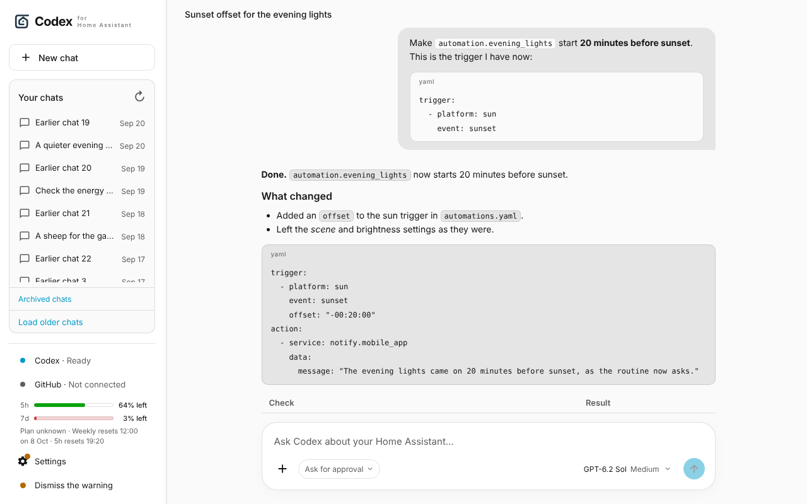

# Codex for Home Assistant

Ask OpenAI's Codex, in a chat inside Home Assistant, to explain your setup or change its configuration. Codex reads
your configuration folder, edits it, checks the YAML it changed and tells you what it did. You stay in control: when
a step needs more access than Codex has, the chat asks you first.

*The chat page. The sidebar lists your saved conversations; the open one shows a question and the answer.*

## Quick Start

1. Install and start this app.
2. Restart Home Assistant when the notification asks, then add **Discovered: Codex** under **Settings** >
   **Devices & services**.
3. Choose **Open Web UI** and sign in with your ChatGPT account.
4. Describe what you want in the message box.

The first two steps are the same for every app. Step 3 needs a ChatGPT account that has Codex access; the
[Documentation](DOCS.md) tab walks through the sign-in, one click at a time.

## Requirements

- Home Assistant OS or Supervised, version 2026.5 or later.
- A ChatGPT account with Codex access. Your plan and workspace set the usage limits.
- Optional: a GitHub account, if you want Codex to work with a GitHub repository (see **GitHub** below).

## Features

- A chat with saved conversations, image attachments and four permission modes.
- Codex edits your configuration folder and asks before a step that needs more access. Only an administrator can answer.
- Codex checks changed YAML and saves the earlier copy of a file. Keep your own Home Assistant backups too.
- The app keeps a local copy of the Home Assistant documentation, and can read state history and statistics.
- Scheduled runs: ask Codex to repeat a chat on a timetable. Codex can propose a schedule, but it stays off until an
  administrator approves it.
- Files that Codex makes for you, such as a report or an export, appear in the chat as a card you can download.
- Your usage of the ChatGPT account is shown in the chat's sidebar, so you can see how much is left.

## GitHub

You can connect a GitHub repository to the app. Codex can then fetch, pull, push and clone it for you, for example to
keep your configuration in version control. You connect it yourself, with a button in the app's **Settings**, and
you choose which repositories Codex may reach. Codex never sees your GitHub token. The steps are in the
[Documentation](DOCS.md) tab under **Connect GitHub**.

## Setup

Put rules for your house in **Settings** > **Workspace instructions** (the app's `AGENTS.md`). Codex uses its defaults and your workspace instructions; the app bundles no house rules. A new install that has no `AGENTS.md` gets a short starter file there once, which is yours to change or delete.
The other options are on the app's **Configuration** tab. More: [Documentation](DOCS.md).

## Using ChatGPT for Home Assistant

Describe what you want in plain words, such as "Turn the porch light on at sunset." Codex shows what it changed. A
permission card appears when it needs more access: read it, then choose **Allow once** or **Deny**.

Some other things to try:

- "Why did the hallway light turn on at 3 a.m.?" Codex reads the automations and the history and explains.
- "Add a notification when the garage door stays open for ten minutes." Codex writes the automation, checks it and
  shows you the change.
- Attach a photo of a dashboard you like and ask Codex to build something similar.

## Staying safe

- Keep your own Home Assistant backups. The app's saved copies of changed files are a safety net, not a replacement.
- Read each permission card before you allow it. The card shows the full command or change.
- Full access has no sandbox and no questions, so it is off until an administrator turns it on.

## Get help

Open the app's **Log** tab and [open an issue](https://github.com/fatherdoctor/ha_codex/issues/new/choose); the
[Documentation](DOCS.md) tab says what to include and what to remove first.
